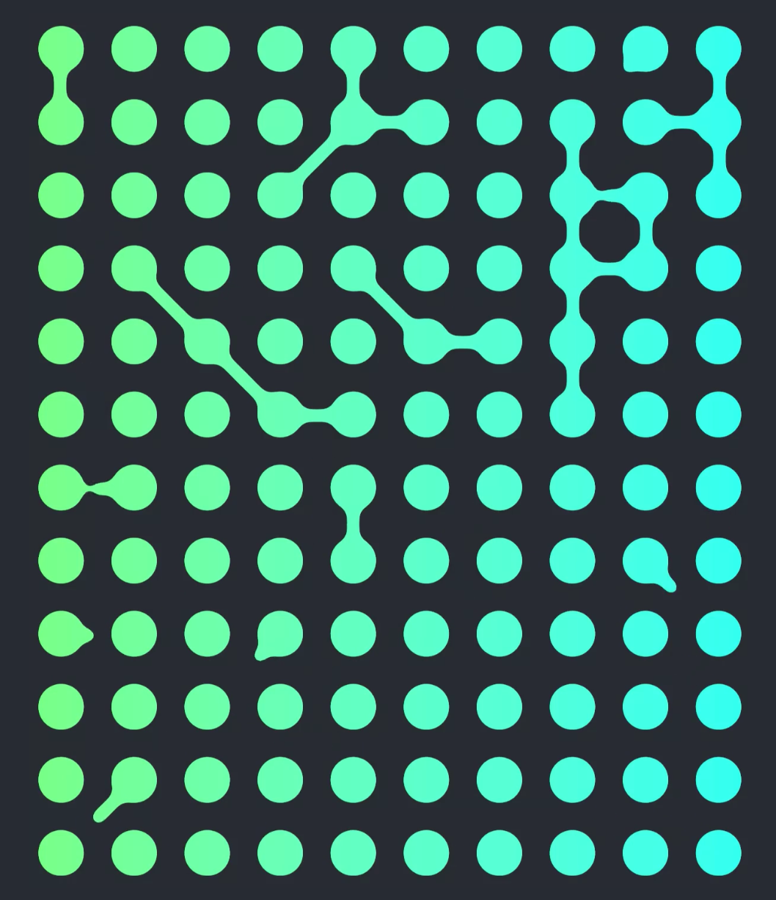
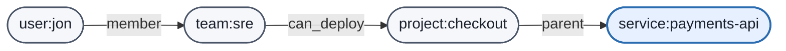
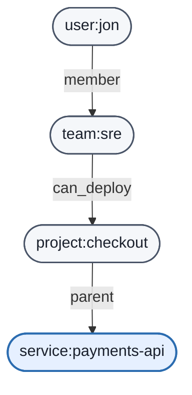
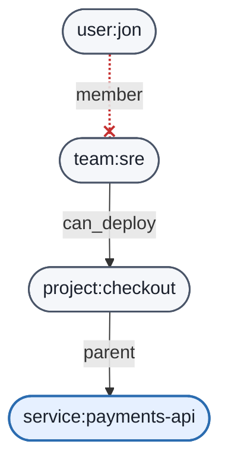
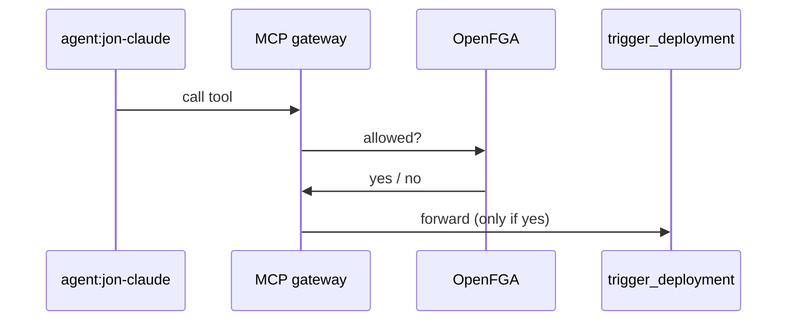

theme: Next
autoscale: true


# OpenFGA
## Fine-Grained Authorization 
## for Apps, APIs, and Agents

##### Will Vedder, OpenFGA maintainer


^ # Myself: Will - Philadelphia, PA - OpenFGA maintainer - Auth0 employee


---

# Poll :wave:

^ How many of you are implementing your own permissioning system?

^ How many have heard of OpenFGA?

^ How many are using OpenFGA in production?


---

## Can `jon` deploy `payments-api`?

### 👨


---

## Can `jon`'s agent deploy the `payments-api` on his behalf?

### 🤖

^ This is a more apt question we're trying to answer


---

# Challenges answering those questions


1. Where are authz decisions made?
2. How granular are the permissions?
3. How are policies expressed?
4. How are AI agents authorized? 🤖

---

## Challenge 1 - Where are authz decisions made?

```go
func canDeploy(user User, svc Service) bool {
    if user.Role == "admin" { return true }
    if user.Team == "sre" { return true }
    if user.Team == svc.OwningTeam { return true }
    if contains(svc.TrustedUsers, user.ID) { return true }
    return false
}
```


^ - some permissions implementations might look like this; inlining logic inside services
- what happens when your 12 services each have their own implementation?
- The challenge isn't obvious but its the *decentralization* of authorization


---

## Challenge 1 - Where are authz decisions made?


[.column]
### Decentralized ❌
- Logic drifts across services
- "Who can deploy this?" = hard to answer
- No audit trail
- Policy changes = coordinated deploys

[.column]
### Centralized ✅
- One source of truth
- *Decision* separate from *enforcement*
- Every decision is auditable
- Policy changes without redeploys

ㅤ


^ This assumes you have multiple services that require authz.
- Decentralized authorization can be a key problem in authorization
- Going back to `canDeploy()`, now imagine 12 copies of it


---

## Challenge 2 - How granular are the permissions?

| **Coarse-grained** 🪨 | **Fine-grained** 🧂 |
| --- | --- |
| *"can_deploy role can deploy all services"* | *"Jon can deploy this service"* |
| Per role | Per user, per resource |
| Static | Inheritance is expressible (teams, projects, services) |


^ Another concept is authz granularity

---

## Challenge 3 - How are policies expressed?

### RBAC, ABAC, ReBAC?


^ Quick review of access control approaches


---

# RBAC

*Role-based access control*

- What role you have => what permissions you have
- **Pros:** Simple, easy to audit
- **Cons:** Coarse-grained => role explosion


---

# ABAC

*Attribute-based access control*

- Authz decision based on attributes of user, resource, and request
- **Pros:** Flexible, handles runtime context
- **Cons:** Reverse-lookup difficult, less auditable, logic scattered in code


---

# ReBAC

*Relationship-based access control*

- Access determined by relationships
- Jon is member of `sre` which can deploy `checkout` projects which include `payments-api` service
- **Pros:** Inheritance native, fine-grained, auditable, reverse lookups simple
- **Cons:** Requires writing/backfilling relationships; some complexity w/ graph

ㅤ


---

| | RBAC | ABAC | ReBAC |
| --- | --- | --- | --- |
| **Per-resource access** | 🟡 | ✅ | ✅ |
| **Inheritance** | ❌ | 🟡 | ✅ |
| **Reverse lookup (what can user access?)** | ✅ | ❌ | ✅ |
| **Runtime context** | ❌ | ✅ | ❌ |
| **Auditing** | ✅ | ❌ | ✅ |
ㅤ


^ - Each access control approach has its own sets of tradeoffs.
- Choosing depends on your domain-specific needs.

---

# What is OpenFGA?


[.column]
- Authorization decision engine
- Google Zanzibar-inspired
- CNCF Incubating
- ReBAC*
- Centralized authz
- Open-source
- 6,100+ stars on GitHub


[.column]


^ Google's globally distributed, consistent authorization system designed to manage fine-grained access control across massive scales.
^ I'd be remiss if I didn't mention our GH stars, very important to OpenFGA's product manager

---

# Fine-grained permissions


^ share dialogue

---

# 📈 OpenFGA Adoption


[.column: width(2)]
- [Linux Foundation](https://github.com/linuxfoundation/)
- [Agent Substrate*](https://github.com/agent-substrate/substrate/tree/main)
- [Grafana](https://github.com/grafana/grafana)
- [Supabase](https://github.com/supabase/supabase)
- [Canonical](https://github.com/canonical/lxd)
- [SigNoz](https://github.com/SigNoz/signoz)
- [Caipe IO](https://github.com/caipe-io/ai-platform-engineering)
- [Platform Mesh](https://github.com/platform-mesh/platform-mesh)


[openfga/community/ADOPTERS.md](https://github.com/openfga/community/blob/main/ADOPTERS.md) 
ㅤ
ㅤ

^ Special mention: Agent substrateㅤ
- Kubernetes-native runtime and workload management system. 
- designed to securely run AI agents at high scale/density.
- Originally created by Google => Comes full-circle with the Google Zanzibar; endorsement


---

# 🛠️ OpenFGA Primitives

- **Authorization Model**
  - *The* access control policy
  - Domain-specific language (DSL)
  - Highly expressive
  - Logical operators (and, or, but not)
- **Tuples**
  - The data that informs object-object relationships
ㅤㅤㅤ
ㅤ
^ Two primitives to introduce


---

# Authorization Model

[.code-highlight: all]

```
model
  schema 1.1

type user

type project
  relations
    define can_deploy: [user]
```
ㅤ
ㅤ

^ - Describes your access control policy.
- Highly specific to your domain.


---

# Authorization Model (cont.)

[.code-highlight: 6-8,12]

```
model
  schema 1.1

type user

type team
  relations
    define member: [user]

type project
  relations
    define can_deploy: [user, team#member]
```

ㅤ
ㅤ


---

# Authorization Model (cont.)

[.code-highlight: 14-17]

```
model
  schema 1.1

type user

type team
  relations
    define member: [user]

type project
  relations
    define can_deploy: [user, team#member]

type service
  relations
    define parent: [project]
    define can_deploy: [user, team#member] or can_deploy from parent
```
ㅤ
ㅤ

^ Point being is that the model is highly expressive and easily maps to your domain


---

# Tuples

- The data that inform object-object relationships
- Paired w/ model = inform authz decisions
- Written by application when events occur (share, invite, delete, add)
- Three parts
  - Object (ex: "project:checkout", "document:roadmap")
  - Relation 
  - Subject (ex: "user:jon")
- Not code
ㅤ
ㅤ


^ DB analogy - if authz model is the schema, tuples are the rows

---

## Example tuples

| **user** | **relation** | **object** |
| --- | --- | --- |
| `user:jon` | `member` | `team:sre` |
| `team:sre#member` | `can_deploy` | `project:checkout` |
| `project:checkout` | `parent` | `service:payments-api` |


---

# Tuples as graph
ㅤ
ㅤㅤ


ㅤ
ㅤ

Can Jon deploy `service:payments-api`?


^ Now visualized as graph
^ OpenFGA is really just a graph reachability problem.


---

# 🔍 Query APIs

- **Check** - does *this user* have *this relation* on *this object*?
- **ListObjects** - which objects can *this user* access?
- **ListUsers** - which users can access *this object*?
  


^ - Query APIs for actually performing authorization
- OpenFGA has a small API surface area with three main query APIs
- First-class methods of checking access 

---

# Check API

[.column: width(2)]
```json
POST /stores/{store_id}/check
{
  "user": "user:jon",
  "relation": "can_deploy",
  "object": "service:payments-api"
}

=> { "allowed": true }
```
[.column: width(1)]


---


## ❌ DELETE - user:jon  member  team:sre

[.code-highlight: 8]
[.column: width(2)]
```json
POST /stores/{store_id}/check
{
  "user": "user:jon",
  "relation": "can_deploy",
  "object": "service:payments-api"
}

=> { "allowed": false }

```

[.column: width(1)]


^ - not reachable in the graph
- Removing tuples may change authz decision
- Again, OpenFGA is just a graph reachability problem.


---


# ListObjects API (reverse lookup)

[.column: width(2)]
```json
POST /stores/{store_id}/list-objects
{
  "relation": "can_deploy",
  "user": "user:jon",
  "type": "service"
}
=> [ "service:payments-api", "service:cart-api", "service:tax-proxy" ] 

```
ㅤ

^ - Check API is bread and butter of most permissions systems
- However, reverse lookups w/ ListObjects API is very common

---

# 🚦 Conditions


Sometimes authz decisions require **context** in addition to relationships.

- OpenFGA's ABAC feature
- CEL expressions
- Allows arbitrary arguments
- Ex:
  - Temporal access
  - Usage-based/feature-based policies (Entitlements) 
  - IP allowlists

ㅤㅤㅤ


^ - Up to this point more beginner content, getting into a more intermediate concept is conditions
 - This is how OpenFGA does ABAC
 - Relationships decide *who*, conditions decide *when/under what circumstances*.

---

# 🚦 Modeling conditions


```
type project
  relations
    define can_deploy: [user with non_expired_grant]


condition non_expired_grant(
  current_time: timestamp, 
  start: timestamp, 
  duration: duration
) {
  current_time < start + duration
}
```
ㅤㅤㅤ

^  - Relationships decide *who*, conditions decide *when/under what circumstances*.

---


| | RBAC | ABAC | ReBAC | **OpenFGA** |
| --- | --- | --- | --- | --- |
| **Per-resource access** | 🟡 | ✅ | ✅ | ✅ |
| **Inheritance** | ❌ | 🟡 | ✅ | ✅ |
| **Reverse lookup** | ✅ | ❌ | ✅ | ✅ |
| **Runtime context** | ❌ | ✅ | ❌ | ✅ (conditions) |
| **Auditing** | ✅ | ❌ | ✅ | ✅ |


^ - After showing conditions satisfy ABAC usecases
- OpenFGA really blends the best of all access control approaches

---

## 🤖 Challenge 4 - How are AI agents authorized?

- New type of principal
- Acting on behalf of users
- Call tools via MCP
- Agents are sneaky, unpredictable


^ Transition. Everything so far was about humans. Now let's add a new kind of principal.


---

## MCP gateways

Natural agent authorization enforcement point, evaluate access before agent invokes tool.





^ Callback to centralized authorization. The gateway is just another service asking OpenFGA the question.

---

## Modeling agents


[.code-highlight: 18-23]

```
model
  schema 1.1

type user

type team
  relations
    define member: [user]

type project
  relations
    define can_deploy: [user, team#member]

type service
  relations
    define parent: [project]
    define can_deploy: [user, team#member] or can_deploy from parent

type agent

type tool
  relations
    define can_call: [agent]
```

ㅤ

^The OpenFGA modeling language can naturally express agents; nothing special here

---

## AI Agents - highly dynamic

- Not enough to know if an agent can call a tool
- Heavily dependent on **request's runtime context**
  - Permissions user granted during session
  - Rate-limits
  - Time of day
  - Arbitrary arguments (e.g. `environment: prod`)
ㅤ
ㅤ


^ - Last couple years, learned operators that authorize AI agents have highly dynamic requirements
- AI agents are sneaky and unpredictable, scoping down access to specific domain needs => a must-have

---


## Dynamic situation example

*Jon's agent should only have permission to deploy non-prod environments*
ㅤ


^ The modeling language can naturally express agents. The gap now is runtime context.
- Runtime context – sounds like "conditions", right?

---

# 🤔 Why not regular conditions? 


[.column]
- Agent rules can vary per task, per session
- Ex:
  - Jon's agent - non-prod only
  - Maria's agent - `payments-api` only, for 1 hour
  - Andres' agent - max 3 deploys
- New kind of rule = new condition in model
  - Requires coordination, review => slow
  - Users delegating to agents can't wait
ㅤ

[.column]
```
condition non_prod_only(environment: string) {
  environment != "prod"
}

condition single_service_ttl(...) {...}

condition max_deploys(...) {...}
```

^ - Regular conditions are great when the rule shapes are known ahead of time.
- With agents, rules are written at delegation time, by the user or the app, and vary wildly.
- We want the rule to be **data** in the tuple, not **schema** in the model. That's Dynamic Conditions.

---

# 🤸‍♀️ Dynamic Conditions

- New OpenFGA feature - built for AI agent authz
- Like conditions, but no model change per rule
- **CEL expressions** attached to tuples, not the model
- Expressions evaluated at query-time

ㅤ

```
define can_call: [agent, agent with $expression]
```
ㅤ


^ The expression lives in the tuple as data, not in the model as schema.**
^ Noted by the `$expression` keyword in DSL


---


```yaml
user: agent:jon-claude
relation: can_call
object: tool:trigger_deployment
condition:
  name: "$expression"
  context:
    expression: "environment != 'prod'"
    parameters:
      environment: string
```


---


[.code-highlight: 7-9]

```yaml
user: agent:jon-claude
relation: can_call
object: tool:trigger_deployment
condition:
  name: "$expression"
  context:
    expression: "environment != 'prod'"
    parameters:
      environment: string
```


---

[.code-highlight: 7,10]
```json
POST /stores/{store_id}/check
{
  "user": "agent:jon-claude",
  "relation": "can_call",
  "object": "tool:trigger_deployment",
  "context": {
    "environment": "staging"
  }
}
→ { "allowed": true }

```
ㅤ
ㅤ


---
[.code-highlight: 7,10]

```json
POST /stores/{store_id}/check
{
  "user": "agent:jon-claude",
  "relation": "can_call",
  "object": "tool:trigger_deployment",
  "context": {
    "environment": "prod"
  }
}
→ { "allowed": false }
```
ㅤ
ㅤ


---

## ⚠️ Hand-waviness

*Just because Jon's agent can deploy doesn't mean that Jon has permissions to deploy too.*
ㅤ
**Either need to:**
- Two checks 
    - Jon's agent `can_call` tool *and* 
    - Jon's `can_deploy` access
- Express directly in authorization model


^ - some sharp observers might be saying, well wait, Jon's agent can call the tool but we didn't check if Jon could deploy the service too!
- 

---


[.code-highlight: 12,23-27]

```
model
  schema 1.1

type user

type agent
  relations
    define owner: [user]

type team
  relations
    define member: [user, agent]

type project
  relations
    define can_deploy: [user, team#member]

type service
  relations
    define parent: [project]
    define can_deploy: [user, team#member] or can_deploy from parent

type tool
  relations
    define service: [service]
    define can_call: [agent, agent with $expression]
    define can_deploy: can_call and can_deploy from service
```
ㅤ
ㅤ

^ - this is what that model would look lik
- probably a bit too complex for a 30 min talk
- point being, OpenFGA is flexible to the application's needs
- It only works if you also write agent:jon-claude member team:sre, and the gateway sends the service tuple as a contextual tuple. Someone may ask, so have that answer ready.

---

## 🤝 Conclusion - OpenFGA

1. **Centralized** decision engine 🌐
2. Fine-grained 🧂
3. Best of ReBAC, ABAC, RBAC 💪
4. Agents as first-class principals w/ dynamic conditions 🤖
ㅤ

*Open-source - CNCF Incubating - SDKs, CLIs, Helm charts - Widely adopted - ... much more*
ㅤㅤ
ㅤ


---

# 📚 Continued exploration

- [Playground](https://play.fga.dev)
- [Docs](https://openfga.dev/docs)
- [Sample implementations](https://github.com/openfga/sample-stores)  (incl. MCP Gateway examples)
- [Dynamic Conditions Announcements](https://openfga.dev/blog/dynamic-abac-expressions-announcement): 
- [Community](https://openfga.dev/community)


^ Point to the MCP Gateway examples: employee-facing, multi-tenant, and intent-based. Invite feedback to the OpenFGA community.

---

# Questions?


